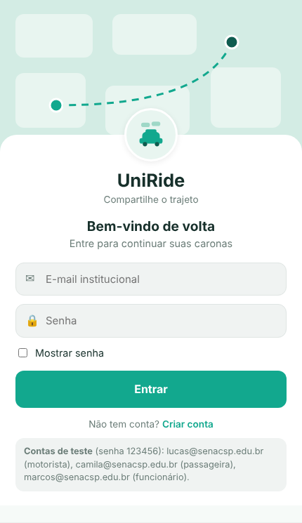
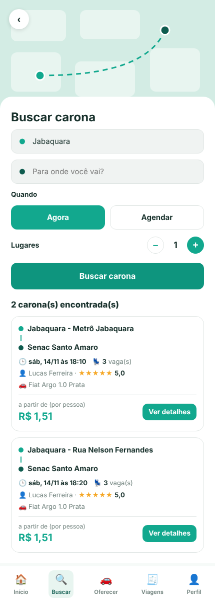
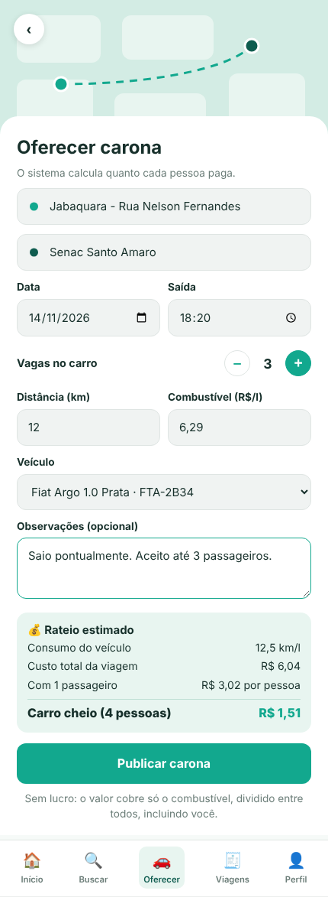
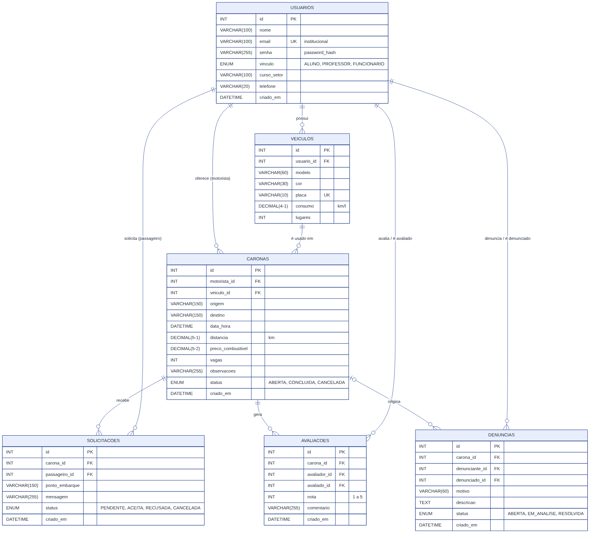
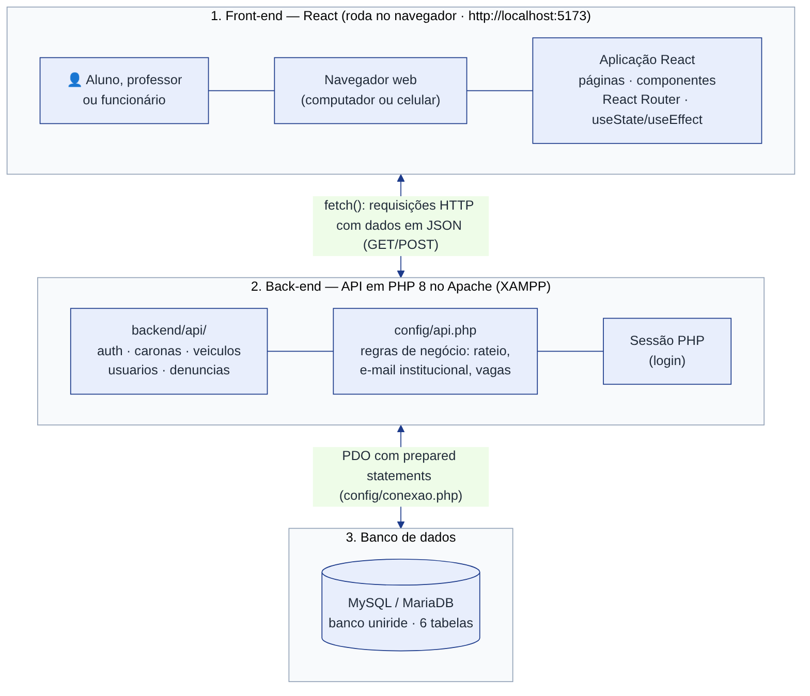

# 🚗 UniRide

**Plataforma web para compartilhamento de caronas entre a comunidade universitária.**

MVP (Produto Mínimo Viável) do **Projeto Integrador: Análise e Soluções Integradas para Organizações**, do curso de Tecnologia em Análise e Desenvolvimento de Sistemas do **Centro Universitário Senac**.

O UniRide conecta motoristas e passageiros de uma mesma instituição de ensino. O acesso é feito somente com e-mail institucional, o custo da viagem é dividido sem lucro e o sistema tem avaliações e canal de denúncias.

O visual segue o protótipo: layout de aplicativo de celular, cores verde e menta, mapa com a rota no topo e menu na parte inferior.

  

## 👥 Integrantes

- André Ricardo Costa da Silva
- Leonardo dos Santos Freire
- Letícia Sá Oliveira
- Lucas Viana de Oliveira
- Lucas Vinícius Silva dos Santos
- Thamires Anjos Ferreira

## 🎥 Vídeo de demonstração

▶️ [Assista ao vídeo](COLE_AQUI_O_LINK_DO_VIDEO)

## 🛠️ Tecnologias

| Parte | Tecnologia | Pasta |
|---|---|---|
| **Front-end** | React 18 + Vite, React Router, HTML e CSS | `frontend/` |
| **Back-end** | API em PHP 8 (sem framework), respostas em JSON | `backend/` |
| **Banco de dados** | MySQL / MariaDB | `database/uniride.sql` |
| Servidor local | XAMPP (Apache + PHP + MySQL) e Node.js (para o React) | |
| Protótipo | Figma | |

## ✅ Funcionalidades

- Cadastro com **e-mail institucional** (`.edu.br`) e login com senha criptografada (`password_hash`)
- Cadastro de veículos (modelo, cor, placa, consumo e lugares)
- Oferecer carona com **cálculo automático do rateio**: `(distância ÷ consumo) × preço do litro ÷ pessoas no carro`
- Buscar caronas por origem, destino, quando (Agora/Agendar) e número de lugares
- Solicitar vaga, aceitar ou recusar pedidos e cancelar
- Concluir a viagem e **avaliar** os participantes (1 a 5 estrelas)
- Perfil com nota média e comentários
- **Denúncia** de problemas para a segurança da universidade

## ▶️ Como executar

Você vai precisar do **[XAMPP](https://www.apachefriends.org/pt_br/index.html)** e do **[Node.js](https://nodejs.org/pt-br)** (versão 18 ou superior).

### 1. Banco de dados e back-end (XAMPP)

1. Abra o **XAMPP Control Panel** e clique em **Start** no **Apache** e no **MySQL**.
2. Copie a pasta `uniride` inteira para `C:\xampp\htdocs\`.
3. Acesse **http://localhost/phpmyadmin**, clique em **Importar**, escolha `database/uniride.sql` e clique em **Importar**.
4. Teste a API acessando **http://localhost/uniride/backend/api/auth/eu.php**. Deve aparecer `{"erro":"Faça login para continuar."}`.

> Se o seu MySQL tiver senha, altere a variável `$senha` em `backend/config/conexao.php`.

### 2. Front-end (React)

Abra o terminal (ou o terminal do VS Code) e rode:

```bash
cd C:\xampp\htdocs\uniride\frontend
npm install
npm run dev
```

Acesse **http://localhost:5173** no navegador.

> O React repassa as chamadas `/api/...` para o XAMPP (configuração `proxy` no arquivo `frontend/vite.config.js`). Por isso o Apache precisa estar ligado.

### Contas de teste (senha `123456`)

| E-mail | Perfil |
|---|---|
| lucas@senacsp.edu.br | Aluno motorista (persona Lucas) |
| camila@senacsp.edu.br | Aluna passageira (persona Camila) |
| marcos@senacsp.edu.br | Funcionário passageiro (persona Marcos) |
| renata@senacsp.edu.br | Professora motorista |
| joao@senacsp.edu.br | Aluno motorista |

Para voltar o banco ao estado inicial, importe `database/uniride.sql` de novo.

## 📁 Estrutura de pastas

```
uniride/
├── frontend/                     FRONT-END (React)
│   ├── index.html
│   ├── vite.config.js            proxy /api → XAMPP
│   └── src/
│       ├── main.jsx              ponto de entrada
│       ├── App.jsx               rotas e controle de login
│       ├── api.js                função que chama a API PHP
│       ├── utils.js              formatação (R$, datas, iniciais)
│       ├── estilo.css
│       ├── components/           Mapa, MenuInferior, CartaoCarona, AvaliarPessoa, Estrelas, Etiqueta
│       └── pages/                Inicio, Login, Cadastro, Painel, Buscar, Oferecer,
│                                 Carona, Denunciar, MinhasCaronas, Perfil
├── backend/                      BACK-END (API em PHP)
│   ├── config/
│   │   ├── conexao.php           conexão com o MySQL (PDO)
│   │   └── api.php               JSON, sessão e regras de negócio (rateio)
│   └── api/
│       ├── auth/                 cadastro, login, logout, eu
│       ├── caronas/              buscar, minhas, detalhe, criar, acao
│       ├── veiculos/             listar, criar, remover
│       ├── usuarios/             painel, perfil
│       └── denuncias/            dados, criar
├── database/uniride.sql          BANCO DE DADOS (tabelas e dados de teste)
└── docs/                         diagramas e telas
```

## 🔌 Rotas da API

| Método | Arquivo | O que faz |
|---|---|---|
| POST | `auth/cadastro.php` | Cria a conta (valida o e-mail institucional) |
| POST | `auth/login.php` | Faz o login |
| POST | `auth/logout.php` | Encerra a sessão |
| GET | `auth/eu.php` | Retorna o usuário logado |
| GET | `usuarios/painel.php` | Dados da tela inicial |
| GET | `usuarios/perfil.php?id=` | Perfil e avaliações |
| GET | `caronas/buscar.php?origem=&destino=&data=` | Busca caronas |
| GET | `caronas/minhas.php?aba=` | Histórico (motorista/passageiro) |
| GET | `caronas/detalhe.php?id=` | Detalhes da carona |
| POST | `caronas/criar.php` | Oferece uma carona |
| POST | `caronas/acao.php` | solicitar, cancelar_pedido, aceitar, recusar, concluir, cancelar_carona, avaliar |
| GET / POST | `veiculos/listar.php` · `criar.php` · `remover.php` | Veículos |
| GET / POST | `denuncias/dados.php` · `criar.php` | Denúncias |

## 🗄️ Banco de dados

Seis tabelas: `usuarios`, `veiculos`, `caronas`, `solicitacoes`, `avaliacoes` e `denuncias`.



## 🏗️ Arquitetura



## 🔭 Próximos passos

- Calcular a distância automaticamente com uma API de mapas
- Login integrado ao sistema acadêmico
- Pagamento via Pix
- Página administrativa para a segurança analisar as denúncias
